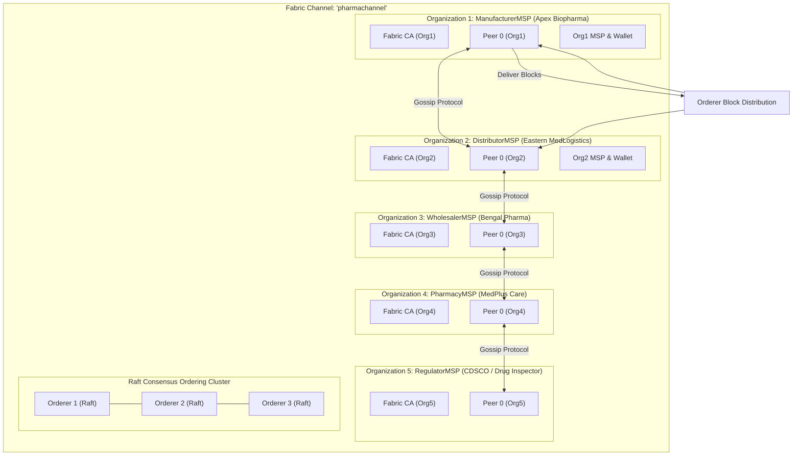
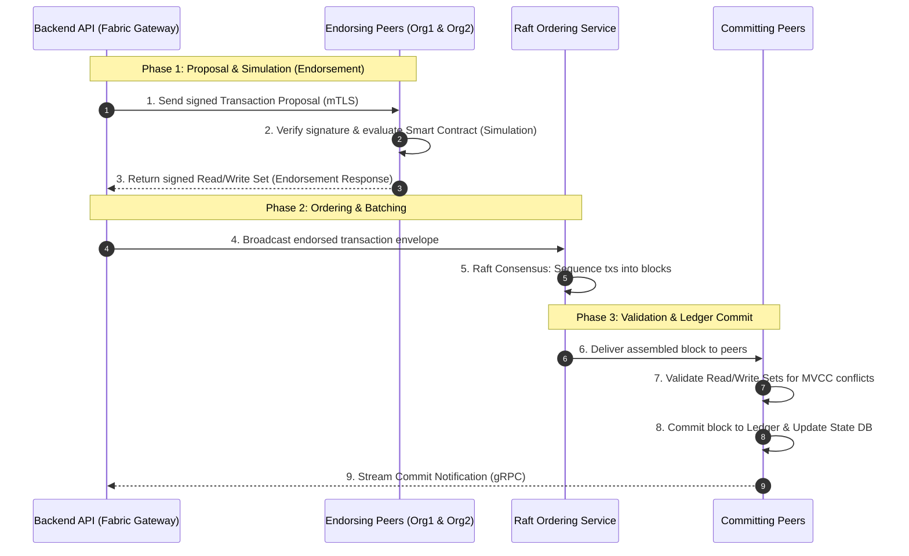

# Blockchain Architecture: Hyperledger Fabric Consortium & Smart Contract Specification

**Academic Research Prototype**  
**Institution:** Rajendra Mishra School of Engineering Entrepreneurship, IIT Kharagpur  
**Project:** Unified Blockchain-Based Pharmaceutical Traceability Platform  
**Author:** Navendu Maiti (Roll: `25RJ92R01`)  

---

## 1. Consortium Network Topology & Channel Architecture

The platform operates on a permissioned enterprise consortium running on **Hyperledger Fabric v2.5 LTS**. Unlike public proof-of-work blockchains, participants are legally vetted enterprise entities whose nodes and client identities are certified by an X.509 Public Key Infrastructure (PKI).



### Key Network Characteristics:
- **Channel Partitioning:** All supply-chain state transitions take place on the private channel \`pharmachannel\`. Unauthorized outside entities cannot observe ledger events or state updates.
- **Raft Ordering Cluster:** Raft consensus provides Crash Fault Tolerance (CFT) with low transaction latency ($< 50$ ms block assembly) and zero wasteful energy expenditure compared to proof-of-work mining.
- **Mutual TLS (mTLS):** All peer-to-peer, peer-to-orderer, and client-to-gateway network sockets mandate TLS 1.3 encryption with mutual certificate authentication.

---

## 2. Smart Contract Function Specifications (\`pharma-contract\`)

The smart contract is implemented in Node.js adhering to the \`fabric-contract-api\` specification. It exposes 10 transactional and query functions with strict state validation:

```text
blockchain/chaincode/pharma-contract/
├── lib/
│   ├── pharmaContract.js      # Main Smart Contract Class (10 functions)
│   ├── product.js             # Product domain model & state key
│   ├── batch.js               # Batch domain model & state key
│   ├── serialUnit.js          # Packaging serial domain model & state key
│   ├── shipment.js            # Shipment manifest & custody handover
│   └── recall.js              # Batch recall record
├── test/
│   └── pharmaContract.test.js # Mocha/Chai Unit Test Suite (17/17 passing)
└── package.json
```

### Smart Contract Methods Summary

| # | Function Name | Permitted Invoker MSP | Key Arguments | State Modifications & Business Rules |
|:---:|:---|:---|:---|:---|
| 1 | \`RegisterProduct\` | \`ManufacturerMSP\` | \`gtin, brandName, genericName, dosageForm, strength, description\` | Creates \`PROD_<gtin>\` ledger key. Rejects if GTIN exists or invoker is not manufacturer. |
| 2 | \`RegisterBatch\` | \`ManufacturerMSP\` | \`batchNumber, gtin, mfgDate, expiryDate, quantity, facility\` | Validates linked GTIN exists. Creates \`BATCH_<batchNo>\`. Sets \`isRecalled = false\`. |
| 3 | \`CreateSerial\` | \`ManufacturerMSP\` | \`serialNumber, batchNumber, cryptographicSignature\` | Creates \`SERIAL_<serialNo>\`. Initializes status to \`CREATED\` and custodian to \`ManufacturerMSP\`. |
| 4 | \`DispatchShipment\` | Current Custodian MSP | \`shipmentCode, receiverMspId, serialNumbersJson, notes\` | Verifies caller owns all packaging units. Sets shipment status to \`DISPATCHED\`, units to \`IN_TRANSIT\`. |
| 5 | \`ReceiveShipment\` | Target Receiver MSP | \`shipmentCode\` | Verifies caller is assigned receiver. Transitions units to \`STOCKED\` and updates \`currentCustodian\`. |
| 6 | \`TransferCustody\` | Current Custodian MSP | \`serialNumber, newCustodianMspId, handoverNotes\` | Point-to-point physical custody handover with audit log entry. |
| 7 | \`RecordSale\` | Stocking Pharmacy MSP | \`serialNumber, pharmacyLicense, saleReceiptHash\` | Transitions unit status to \`SOLD\` and custodian to \`CONSUMER\`. Irreversible final state. |
| 8 | \`RecallBatch\` | \`ManufacturerMSP\`, \`RegulatorMSP\` | \`batchNumber, reason, severity\` | Sets \`batch.isRecalled = true\`. Emits high-priority event \`BatchRecalled\`. |
| 9 | \`VerifyProduct\` | *Public Read (Any MSP)* | \`serialNumber\` | Evaluates existence, linked batch expiration, recall status, and sale status. |
| 10| \`GetProductHistory\`| *Public Read (Any MSP)* | \`serialNumber\` | Iterates over \`ctx.stub.getHistoryForKey()\` returning complete cryptographic custody timeline. |

---

## 3. Zero-Trust Identity Enforcement Pattern

A critical security vulnerability in naive blockchain APIs is trusting an organization identifier passed in the JSON payload (e.g. \`req.body.organizationId\`). An attacker could alter this field to impersonate another supply-chain entity.

The \`pharma-contract\` strictly enforces zero-trust identity extraction using the cryptographic Fabric Certificate Authority client identity:

```javascript
// blockchain/chaincode/pharma-contract/lib/pharmaContract.js

_getCallerMSP(ctx) {
    // Cryptographically verified by the Fabric Peer during mTLS connection
    const clientMsp = ctx.clientIdentity.getMSPID();
    if (!clientMsp) {
        throw new Error('Access Denied: Caller MSP identity could not be verified.');
    }
    return clientMsp;
}

async RegisterProduct(ctx, gtin, brandName, ...) {
    const callerMsp = this._getCallerMSP(ctx);
    
    // Enforcement: Only verified Manufacturer MSPs can author product master data
    if (callerMsp !== 'ManufacturerMSP') {
        throw new Error(`Unauthorized: Caller '${callerMsp}' is not authorized to register products. Only 'ManufacturerMSP' is permitted.`);
    }
    // ...
}
```

---

## 4. Hyperledger Fabric Transaction Lifecycle

Every write operation executes through the rigorous 4-phase Fabric transaction lifecycle:



---

## 5. Gateway Client Architecture & Dual Mode Operation

The backend communicates with Fabric via \`@hyperledger/fabric-gateway\` v1.7. To enable rapid academic development and automated CI/CD without requiring 16 GB of Docker RAM on local laptops, the platform incorporates an **Academic Simulation Engine**:

- **Live Production Mode (\`isLiveNetworkAvailable = true\`):** Connects to physical peer nodes via gRPC using mutual TLS and connection profiles (\`blockchain/gateway/profiles/connection-org1-manufacturer.json\`).
- **Academic Simulation Mode (\`isLiveNetworkAvailable = false\`):** Seamlessly executes the exact production Smart Contract code (\`PharmaContract\`) against an in-process deterministic state engine. All access controls, MSP identities, and state validations execute identically, guaranteeing 100% test fidelity.

