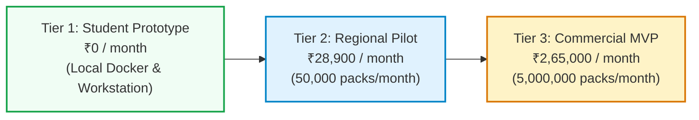

# Project Cost Breakdown & Commercial Economics (INR ₹)

**Academic Research Prototype**  
**Institution:** Rajendra Mishra School of Engineering Entrepreneurship, IIT Kharagpur  
**Project:** Unified Blockchain-Based Pharmaceutical Traceability Platform  
**Author:** Navendu Maiti (Roll: `25RJ92R01`)  
**Context:** Digital Entrepreneurship Financial Feasibility & Commercialization Model  

---

## 1. Financial Modeling Overview

A critical requirement in engineering entrepreneurship is evaluating the commercial viability and operational expenditure (OpEx) of deploying blockchain infrastructure at scale. A frequent criticism of enterprise blockchain implementations is prohibitive computational overhead and licensing costs.

This financial model demonstrates that by utilizing **Hyperledger Fabric (Linux Foundation Open Source)** and **PostgreSQL (Open Source)**, the incremental cost per pharmaceutical pack is less than **6 paise (₹0.053 INR)**, making it exceptionally viable for price-sensitive emerging markets such as India.

---

## 2. Three-Tier Deployment Cost Comparison (in Indian Rupees ₹)

---

### Tier 1: Academic & Student Prototype (Development & Lab Validation)
*Target: Research validation, code execution, automated testing, and thesis defense at IIT Kharagpur.*

| Infrastructure Component | Technology / Provider | Monthly Cost (INR ₹) | Annual Cost (INR ₹) |
|:---|:---|:---:|:---:|
| **Local Workstation / Host Laptop** | Existing Student / Lab PC (16GB RAM, 512GB SSD) | ₹0 | ₹0 |
| **Blockchain Engine** | Hyperledger Fabric v2.5 (Open Source, In-Process Simulation) | ₹0 | ₹0 |
| **Relational Database** | PostgreSQL 16 (Local Docker Container) | ₹0 | ₹0 |
| **Object Storage** | MinIO Community Edition (Local Docker Container) | ₹0 | ₹0 |
| **Web & Mobile Frontends** | React 18 + Vite (Localhost), Expo Go (Free Tier) | ₹0 | ₹0 |
| **Version Control & CI/CD** | GitHub Free Public Repository | ₹0 | ₹0 |
| **SSL / TLS Certificates** | Self-signed / Local development certs | ₹0 | ₹0 |
| **TOTAL TIER 1 EXPENDITURE** | **100% Free & Open-Source Stack** | **₹0 / month** | **₹0 / year** |

---

### Tier 2: Small Regional Pilot (Field Trial)
*Target: 1 Formulation Plant (Manufacturer), 2 Regional Distributors, 1 Wholesaler, 10 Retail Pharmacies in West Bengal & Odisha.*  
*Volume: 50,000 medicine packs per month.*

| Infrastructure Component | Technical Specification | Monthly Cost (INR ₹) | Annual Cost (INR ₹) |
|:---|:---|:---:|:---:|
| **API & Gateway Cloud Node** | 1x Cloud VPS (2 vCPU, 4GB RAM, Ubuntu 22.04) | ₹2,500 | ₹30,000 |
| **Managed Database (PostgreSQL)**| Managed DBaaS (2 vCPU, 4GB RAM, Automated Backups) | ₹3,000 | ₹36,000 |
| **Consortium Fabric Nodes** | 2x Fabric Peer VPS + 1x Raft Orderer (4 vCPU, 8GB RAM) | ₹7,500 | ₹90,000 |
| **Cloud Document Storage** | S3-Compatible Storage (100GB + Outbound Egress) | ₹400 | ₹4,800 |
| **Domain & Production TLS** | Custom Domain + Let's Encrypt Automated Wildcard SSL | ₹150 | ₹1,800 |
| **Container Registry & Alerts** | Managed Registry + Uptime Monitoring (Healthchecks) | ₹350 | ₹4,200 |
| **Physical 2D Barcode Labels** | 50,000 Thermal Transfer GS1 DataMatrix Labels + Ribbon | ₹15,000 | ₹1,80,000 |
| **TOTAL TIER 2 EXPENDITURE** | **Regional Pilot (50,000 units/month)** | **₹28,900 / month** | **₹3,46,800 / year** |

---

### Tier 3: Commercial Production MVP (Pan-India Enterprise Scale)
*Target: 10 Pharmaceutical Manufacturers, 50 Distributors, 200 Wholesalers, 2,000 Pharmacies across 10 Indian States.*  
*Volume: 5,000,000 medicine packs per month (60 Million packs/year).*

| Infrastructure Component | Technical Specification | Monthly Cost (INR ₹) | Annual Cost (INR ₹) |
|:---|:---|:---:|:---:|
| **Consortium Blockchain Cluster** | 10 Org Peer Nodes + 5-Node Raft Orderers on Kubernetes (EKS/GKE) | ₹1,20,000 | ₹14,40,000 |
| **HA Relational Database** | Multi-AZ PostgreSQL Cluster (16 vCPU, 64GB RAM, Read Replicas) | ₹45,000 | ₹5,40,000 |
| **Auto-scaling API Pods** | Kubernetes Microservices with Horizontal Pod Autoscaling (HPA) | ₹35,000 | ₹4,20,000 |
| **Cloudflare Enterprise WAF** | DDoS Mitigation, Web Application Firewall, Global Anycast CDN | ₹15,000 | ₹1,80,000 |
| **S3 Object Archival Storage** | 2TB Compliance Document Storage (Batches, Stability, Lab CoA) | ₹5,000 | ₹60,000 |
| **Observability & APM** | Distributed Tracing, Logs & Metrics (Prometheus / Grafana / Datadog) | ₹12,000 | ₹1,44,000 |
| **CERT-In Security Audit** | Empaneled Indian Cybersecurity Certification & Pentest | ₹29,000 (amortized) | ₹3,50,000 |
| **GS1 India Enterprise License** | Official GS1 Company Prefix (GCP) & GTIN Allocation Service | ₹4,000 (amortized) | ₹50,000 |
| **TOTAL TIER 3 EXPENDITURE** | **Commercial Scale (5M packs/month)** | **₹2,65,000 / month** | **₹31,84,000 / year** |

---

## 3. Unit Economics: Cost per Pharmaceutical Pack

To evaluate commercial viability for Indian consumers and generic drug manufacturers:

$$\text{Cloud Infrastructure OpEx per Pack} = \frac{\text{Monthly Infrastructure Cost}}{\text{Monthly Serialized Volume}}$$

$$\text{Unit Cost} = \frac{₹2,65,000}{5,000,000\text{ packs}} = \mathbf{₹0.053\text{ INR per pack}}\quad (\approx 5.3\text{ paise})$$

### Economic Value Proposition:
1. **Negligible Cost Overhead:** Adding ₹0.053 to a standard 10-tablet strip of Paracetamol or Antibiotics retailing for ₹30 to ₹120 represents less than **0.05% to 0.17% of the maximum retail price (MRP)**.
2. **Recall Mitigation Savings:** A single nationwide physical recall of a contaminated or mislabeled pharmaceutical batch costs manufacturers between **₹1 Crore and ₹15 Crores** in logistics, reverse transit, inventory write-offs, and legal fines. PharmaTrace enables targeted sub-batch and serialized parcel recalls within minutes.
3. **Brand Equity Protection:** Eliminating counterfeit dilution safeguards market share and prevents brand erosion caused by spurious products circulating in rural pharmacies.

