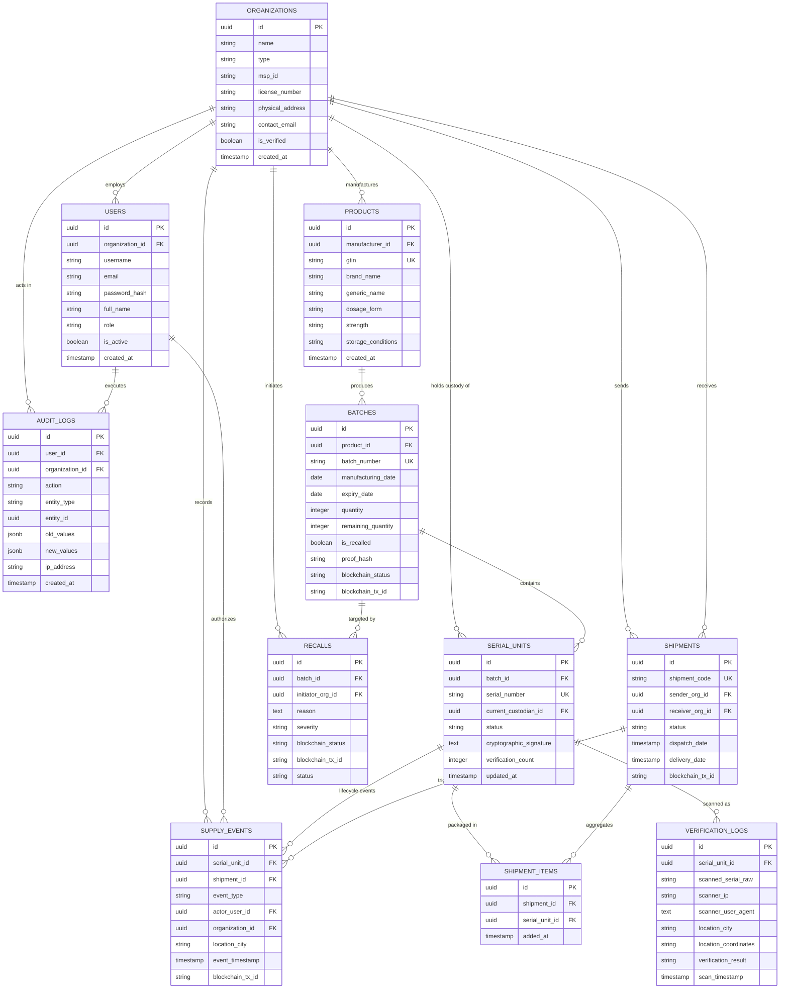

# Database Design: PostgreSQL Relational Schema & Indexing Strategy

**Academic Research Prototype**  
**Institution:** Rajendra Mishra School of Engineering Entrepreneurship, IIT Kharagpur  
**Project:** Unified Blockchain-Based Pharmaceutical Traceability Platform  
**Author:** Navendu Maiti (Roll: `25RJ92R01`)  

---

## 1. Entity-Relationship (ER) Diagram

The relational database is architected in **PostgreSQL 16** with 11 normalized tables adhering to strict 3NF (Third Normal Form) integrity constraints, UUIDv4 primary keys, and comprehensive indexing:



---

## 2. Table Specifications & Constraints

### 2.1 Organizations (\`organizations\`)
- **Primary Key:** \`id UUID DEFAULT uuid_generate_v4()\`
- **Natural Key:** \`license_number VARCHAR(100) UNIQUE\` (e.g. CDSCO manufacturing or retail drug license)
- **MSP Association:** \`msp_id VARCHAR(50) NOT NULL UNIQUE\` (\`ManufacturerMSP\`, \`DistributorMSP\`, etc.)
- **Organization Types:** \`CHECK (type IN ('MANUFACTURER', 'DISTRIBUTOR', 'WHOLESALER', 'PHARMACY', 'REGULATOR'))\`

### 2.2 Users (\`users\`)
- **Role Enforcement:** \`CHECK (role IN ('ADMIN', 'OPERATOR', 'AUDITOR', 'INSPECTOR', 'DISPENSER'))\`
- **Password Protection:** \`password_hash VARCHAR(255) NOT NULL\` (Argon2id format)
- **Unique Constraint:** \`UNIQUE(email)\` and \`UNIQUE(username)\`

### 2.3 Batches (\`batches\`)
- **Composite Integrity:** Unique \`batch_number\`, foreign key referencing \`products(id)\`.
- **Integrity Proof:** \`proof_hash VARCHAR(64) NOT NULL\` (Deterministic SHA-256 of batch creation metadata).
- **Consensus State:** \`blockchain_status VARCHAR(50) DEFAULT 'PENDING' CHECK (blockchain_status IN ('PENDING', 'COMMITTED', 'FAILED'))\`

### 2.4 Packaging Serial Units (\`serial_units\`)
- **Packaging Token:** \`serial_number VARCHAR(100) NOT NULL UNIQUE\` (Format: \`MED-IN-XXXX-XXXX-XXXX\`).
- **State Machine:** \`CHECK (status IN ('CREATED', 'PACKED', 'IN_TRANSIT', 'STOCKED', 'SOLD', 'RECALLED', 'SUSPICIOUS'))\`.
- **Anti-Cloning Counter:** \`verification_count INTEGER DEFAULT 0\`.

### 2.5 Verification Logs (\`verification_logs\`)
- Records consumer and regulator scans with telemetry: IP address, user-agent string, city, coordinates (\`lat,lon\`), and evaluation result.
- **Allowed Results:** \`CHECK (verification_result IN ('AUTHENTIC', 'EXPIRED', 'RECALLED', 'ALREADY_SOLD', 'UNKNOWN_SERIAL', 'SUSPICIOUS_VELOCITY'))\`.

---

## 3. High-Performance Indexing Strategy

To guarantee sub-millisecond query execution even with millions of scanned medicine packs:

```sql
-- High-frequency lookup indexes
CREATE INDEX idx_products_gtin ON products(gtin);
CREATE INDEX idx_batches_number ON batches(batch_number);
CREATE INDEX idx_serials_number ON serial_units(serial_number);
CREATE INDEX idx_serials_custodian ON serial_units(current_custodian_id);
CREATE INDEX idx_serials_status ON serial_units(status);

-- Foreign-key junction indexes
CREATE INDEX idx_shipment_items_shipment ON shipment_items(shipment_id);
CREATE INDEX idx_shipment_items_serial ON shipment_items(serial_unit_id);
CREATE INDEX idx_supply_events_serial ON supply_events(serial_unit_id);

-- Anomaly detection & audit indexing
CREATE INDEX idx_verification_logs_serial ON verification_logs(scanned_serial_raw);
CREATE INDEX idx_verification_logs_timestamp ON verification_logs(scan_timestamp);
CREATE INDEX idx_verification_logs_result ON verification_logs(verification_result);
CREATE INDEX idx_audit_logs_created_at ON audit_logs(created_at);
```

---

## 4. Key Analytical SQL Queries

### Query 1: Complete Custodial Handover History
```sql
SELECT 
    s.serial_number,
    e.event_type,
    o.name AS organization_name,
    o.type AS organization_type,
    u.full_name AS authorized_by,
    e.location_city,
    e.event_timestamp,
    e.blockchain_tx_id
FROM supply_events e
JOIN serial_units s ON e.serial_unit_id = s.id
JOIN organizations o ON e.organization_id = o.id
LEFT JOIN users u ON e.actor_user_id = u.id
WHERE s.serial_number = 'MED-IN-9FXJ-3TEP-CGHB'
ORDER BY e.event_timestamp ASC;
```

### Query 2: Batch Recall Blast Radius (Affected Stock Locations)
```sql
SELECT 
    b.batch_number,
    p.brand_name,
    s.serial_number,
    s.status AS current_status,
    o.name AS current_custodian,
    o.physical_address,
    o.contact_email
FROM serial_units s
JOIN batches b ON s.batch_id = b.id
JOIN products p ON b.product_id = p.id
JOIN organizations o ON s.current_custodian_id = o.id
WHERE b.batch_number = 'B2026-STG7'
  AND s.status NOT IN ('SOLD', 'RECALLED');
```
