# Project Overview: Blockchain-Based Pharmaceutical Authentication & Traceability Platform

**Academic Research Prototype**  
**Institution:** Rajendra Mishra School of Engineering Entrepreneurship, Indian Institute of Technology (IIT) Kharagpur  
**Course / Subject:** Digital Entrepreneurship & Advanced Enterprise Systems  
**Author / Researcher:** Navendu Maiti (Roll No: `25RJ92R01`)  
**Repository:** \`pharma-traceability\`  
**Version:** 1.0.0 (Academic Prototype)  

---

## 1. Executive Summary & Research Motivation

The infiltration of counterfeit, substandard, and adulterated pharmaceuticals poses a catastrophic global healthcare risk. According to the World Health Organization (WHO), over **10.5% of medical products** in low- and middle-income countries (LMICs) are substandard or falsified, causing hundreds of thousands of preventable fatalities annually and costing global healthcare systems tens of billions of dollars.

In India, while the **Central Drugs Standard Control Organisation (CDSCO)** and Ministry of Health and Family Welfare (MoHFW) have mandated QR-code serialization for top 300 active pharmaceutical ingredients (APIs) under GSR 828(E), conventional serialized systems suffer from three fundamental vulnerabilities:

1. **Centralized Database Vulnerabilities:** Single points of failure, vulnerable to malicious insider tampering, database record alteration, and administrator compromise.
2. **Physical Cloning of 2D Barcodes:** Unscrupulous actors can photocopy genuine GS1 DataMatrix or QR codes from legitimate medicine packaging and adhere them onto thousands of counterfeit medicine packs.
3. **Fragmented Custody Visibility:** Handover between Manufacturer $\rightarrow$ Carrying and Forwarding Agent (CFA) $\rightarrow$ Distributor $\rightarrow$ Wholesaler $\rightarrow$ Retail Pharmacy lacks cryptographic non-repudiation.

This project designs, engineers, and evaluates a **Unified Hybrid Blockchain Architecture** uniting:
- **Off-Chain Operational Store (PostgreSQL 16):** For low-latency queries, full-text searching, geospatial indexing, and UI caching.
- **On-Chain Consortium Distributed Ledger (Hyperledger Fabric v2.5 LTS):** For immutable state proofs, decentralized smart contracts, multi-party endorsement policies, and cryptographic auditability.
- **Dynamic Anomaly Engine:** Operating real-time **Haversine Velocity Anomaly Detection** and duplicate scan pattern analytics to defeat cloned packaging counterfeits.

```mermaid
flowchart LR
    A["Manufacturer\n(Apex Biopharma)"] -->|"Dispatches\nShipment"| B["Distributor\n(Eastern MedLogistics)"]
    B -->|"Transfers\nCustody"| C["Wholesaler\n(Bengal Pharma)"]
    C -->|"Receives &\nStocks"| D["Pharmacy\n(MedPlus Care)"]
    D -->|"Dispenses\nMedicine"| E["Consumer / Patient\n(Mobile App Scan)"]

    style A fill:#e0f2fe,stroke:#0284c7,stroke-width:2px;
    style B fill:#f0fdf4,stroke:#16a34a,stroke-width:2px;
    style C fill:#fef3c7,stroke:#d97706,stroke-width:2px;
    style D fill:#fce7f3,stroke:#db2777,stroke-width:2px;
    style E fill:#f3e8ff,stroke:#7c3aed,stroke-width:2px;
```



---

## 2. Core Philosophy & Architectural Axiom

The system operates under the foundational axiom:

$$\mathbf{One\ Product} \implies \mathbf{One\ Cryptographic\ Digital\ Identity} \implies \mathbf{One\ Verifiable\ History}$$

1. **Single Point of Truth without Centralized Monopoly:** No single corporate entity or database administrator owns the entire ledger. State transitions require consensus across independent peer nodes.
2. **Zero-Trust Identity Enforcement:** Smart contract state changes evaluate the caller's X.509 certificate Membership Service Provider ID (\`ctx.clientIdentity.getMSPID()\`), strictly rejecting spoofed payload attributes.
3. **Defense-in-Depth Anti-Counterfeiting:** Acknowledging that digital ledgers cannot physically prevent barcode photocopying, the system pairs blockchain provenance with spatio-temporal velocity anomaly detection and packaging tamper-evidence.

---

## 3. Technology Stack & Compatibility Matrix

| Tier | Component | Selected Technology | Version | Rationale & Compatibility |
|:---|:---|:---|:---:|:---|
| **Consortium Ledger** | Hyperledger Fabric | Fabric v2.5 LTS | 2.5.9 | Long Term Support release with robust Raft BFT ordering and gateway stability. |
| **Blockchain Client** | Fabric Gateway | \`@hyperledger/fabric-gateway\` | ^1.7.1 | Official high-level client SDK using gRPC, replacing legacy Fabric Network SDK. |
| **Smart Contracts** | Chaincode Engine | Node.js Contract API | \`fabric-contract-api\` 2.5.x | Native JavaScript/TypeScript support, running deterministic transaction logic. |
| **Operational Store**| Relational DB | PostgreSQL | 16.x | ACID compliance, UUIDv4 keys, JSONB audit storage, and B-tree indexes. |
| **Object Store** | File Storage | MinIO / S3 Compatible | RELEASE.2024+ | Secure storage for batch stability certificates, lab tests, and CoA docs. |
| **API Backend** | REST Microservices | Node.js / Express | Node 20/24 LTS, Express 4.21 | Asynchronous non-blocking I/O with high concurrency for verification queries. |
| **Cryptography** | Hash & Encryption | Argon2id & SHA-256 | \`argon2\` 0.41, \`crypto\` native | Password hashing resistant to GPU/ASIC attacks; RFC 6962 deterministic hashing. |
| **Web Frontend** | Stakeholder Dashboards | React 18 + Vite | React 18.3, Vite 5.4 | Ultra-fast HMR, Tailwind CSS v3 for enterprise responsive multi-portal UI. |
| **Mobile App** | Consumer Scanner | React Native + Expo | Expo SDK 51+ | Cross-platform camera barcode scanning with instant deep-link parsing. |

---

## 4. Repository Monorepo Structure

```text
pharma-traceability/
├── docs/                           # Architecture, security, API & benchmarking documentation
│   ├── project-overview.md
│   ├── system-architecture.md
│   ├── blockchain-architecture.md
│   ├── database-design.md
│   ├── api-documentation.md
│   ├── security-design.md
│   ├── deployment-guide.md
│   ├── testing-plan.md
│   ├── cost-breakdown.md
│   ├── benchmark-results.md
│   └── benchmark-results.json
├── backend/api/                    # Express REST API, Auth, Blockchain Gateway & Anomaly Engine
│   ├── src/
│   │   ├── config/                 # Database, Fabric, and Environment configs
│   │   ├── controllers/            # Route controllers (Auth, Products, Shipments, Recalls, etc.)
│   │   ├── middleware/             # JWT auth, RBAC, Rate limiter, Error handler, Zod validators
│   │   ├── routes/                 # Express API router declarations
│   │   ├── services/               # Business logic, Fabric Gateway, and Anomaly Detection
│   │   ├── utils/                  # Argon2, Canonical SHA-256, GS1 QR Generator, Logger
│   │   ├── validators/             # Zod input schemas
│   │   ├── tests/                  # Automated mocha/chai, unit, supply chain & benchmark tests
│   │   ├── app.js                  # Express app initialization
│   │   └── server.js               # HTTP server entrypoint
│   └── package.json
├── blockchain/
│   ├── chaincode/pharma-contract/  # Smart contract (Node.js contract implementing 10 functions)
│   │   ├── lib/                    # Smart contract source code
│   │   ├── test/                   # Mocha/Chai MockStub test suite (17/17 passing)
│   │   └── package.json
│   ├── gateway/profiles/           # Connection profiles for Org1 (Manufacturer) & Org2 (Distributor)
│   └── network/                    # Fabric docker compose, crypto-config & deployment scripts
├── frontend/web/                   # React 18 + Vite + Tailwind CSS web dashboard
│   ├── src/
│   │   ├── components/             # Navbar, Sidebar, QRModal, StatusBadges
│   │   ├── context/                # AuthContext with 1-click stakeholder role switching
│   │   ├── pages/                  # Products, Batches, Serials, Shipments, Recalls, Verification
│   │   ├── services/               # Axios/Fetch API client
│   │   └── App.jsx
│   └── package.json
├── mobile/app/                     # React Native Expo consumer verification mobile app
│   ├── src/
│   │   ├── components/             # ScannerOverlay, StatusBadge
│   │   ├── screens/                # HomeScreen, ScannerScreen, ProductResultScreen, HistoryScreen
│   │   └── services/               # Deep-link QR parser & REST client
│   └── App.js
├── database/                       # PostgreSQL schema, migrations, and seed scripts
│   ├── schema.sql                  # 11 relational tables with UUIDs & indexes
│   └── seeds/                      # Initial Indian pharmaceutical ecosystem data
├── docker-compose.yml              # Container definitions (PostgreSQL 16 + MinIO)
└── README.md
```

---

## 5. Academic Scope & Boundary Disclaimers

> [!NOTE]
> This software system is developed as an **Academic Research Prototype** at the Rajendra Mishra School of Engineering Entrepreneurship, IIT Kharagpur. It is designed to demonstrate technical feasibility, architectural decoupling, and empirical performance metrics.
>
> While it incorporates industry best-practices (Argon2id password hashing, GS1 DataMatrix compliance, X.509 MSP authorization, and Haversine velocity anomaly calculation), **it does not claim out-of-the-box formal regulatory validation** under US FDA 21 CFR Part 11, European EMA Annex 11, or CDSCO Good Manufacturing Practice (GMP) audit certifications, which require formal operational qualification (OQ), installation qualification (IQ), and performance qualification (PQ) documentation in a validated manufacturing environment.

