# Security Design: Threat Model, Cryptographic Controls & Anti-Cloning Architecture

**Academic Research Prototype**  
**Institution:** Rajendra Mishra School of Engineering Entrepreneurship, IIT Kharagpur  
**Project:** Unified Blockchain-Based Pharmaceutical Traceability Platform  
**Author:** Navendu Maiti (Roll: `25RJ92R01`)  

---

## 1. Threat Modeling (STRIDE Analysis)

The pharmaceutical supply chain is targeted by sophisticated counterfeiters, corrupt middlemen, and digital adversaries. The table below maps threat vectors to architectural mitigations:

| STRIDE Threat Category | Real-World Threat Scenario in Pharma SCM | Architectural Mitigation in PharmaTrace |
|:---|:---|:---|
| **Spoofing Identity** | Malicious actor registers a fake organization or pretends to be a licensed manufacturer. | **X.509 PKI & Fabric CA:** Only consortium-approved organizations possess enrolled cryptographic certificates. Chaincode validates \`ctx.clientIdentity.getMSPID()\`. |
| **Tampering with Data** | Rogue database admin changes batch expiry date or deletes a recall flag in PostgreSQL. | **Immutable Distributed Ledger:** Expiry dates, batch hashes, and recalls reside on Hyperledger Fabric. Tampering with PostgreSQL is immediately detected via proof-hash mismatch. |
| **Repudiation** | Manufacturer denies releasing a contaminated batch, or distributor denies receiving a shipment. | **Digital Signatures & Endorsement:** Dispatches and batch registrations require cryptographically signed transactions stored permanently in immutable blocks. |
| **Information Disclosure** | Competitors or consumers inspect confidential trade secrets, pricing agreements, or patient records. | **Off-Chain Isolation & Private Channels:** Commercial pricing and patient identity are never written on-chain. Ledgers only contain GTINs, serials, and cryptographic status tokens. |
| **Denial of Service** | Botnet floods consumer verification endpoint, preventing legitimate patients from checking medicines. | **Tiered Rate Limiting & Edge Caching:** Strict windowed rate limiters (\`express-rate-limit\`), query concurrency caps, and read-only evaluate transaction routing. |
| **Elevation of Privilege** | Warehouse operator attempts to trigger a nationwide Class-I batch recall. | **Role-Based Access Control (RBAC) & MSP Rules:** Smart contract explicitly restricts \`RecallBatch\` to \`ManufacturerMSP\` and \`RegulatorMSP\` identities. |

---

## 2. The 2D Barcode Cloning Dilemma & Defense-in-Depth

> [!CRITICAL]
> **Fundamental Anti-Counterfeiting Axiom:**  
> A blockchain ledger records digital state transitions with mathematical immutability; **it cannot physically prevent someone from aiming a laser scanner or camera at a genuine medicine box, photocopying the 2D DataMatrix code, and pasting it onto 10,000 counterfeit packages.**  
> Anyone claiming "blockchain alone stops counterfeiting" misunderstands physical-digital boundary security.

To solve the physical cloning dilemma, PharmaTrace deploys a **Three-Pillar Defense-in-Depth Architecture**:

```mermaid
flowchart TD
    subgraph Pillar1["Pillar 1: Irreversible State Transitions"]
        P1A["Initial Status: CREATED / STOCKED"]
        P1B["Retail Sale at Pharmacy: Transition to 'SOLD'"]
        P1C["Subsequent Consumer Scan Alerts: 'ALREADY_SOLD / DUPLICATE'"]
        P1A --> P1B --> P1C
    end

    subgraph Pillar2["Pillar 2: Spatio-Temporal Velocity Engine"]
        P2A["Scan 1: Kolkata (22.57°N, 88.36°E) at 10:00 AM"]
        P2B["Scan 2: Mumbai (19.08°N, 72.88°E) at 10:05 AM"]
        P2C["Haversine Math: 1,654 km in 5 minutes = 19,848 km/h"]
        P2D["Alert: 'SUSPICIOUS_VELOCITY' (Cloned QR Code Detected)"]
        P2A --> P2B --> P2C --> P2D
    end

    subgraph Pillar3["Pillar 3: Physical Packaging Integrity"]
        P3A["Tamper-Evident Holographic Break-Away Seals"]
        P3B["Scratch-Off Cryptographic PIN Verification"]
        P3C["Overt & Covert Tagging (UV Reactive Inks)"]
        P3A --- P3B --- P3C
    end
```

### Mathematical Velocity Anomaly Formulation:
The Anomaly Engine calculates the Great-Circle distance between consecutive scans using the spherical Haversine formula:

$$\Delta\phi = \phi_2 - \phi_1, \quad \Delta\lambda = \lambda_2 - \lambda_1$$

$$a = \sin^2\left(\frac{\Delta\phi}{2}\right) + \cos(\phi_1)\cos(\phi_2)\sin^2\left(\frac{\Delta\lambda}{2}\right)$$

$$c = 2 \cdot \arctan2\left(\sqrt{a}, \sqrt{1-a}\right)$$

$$d = R \cdot c \quad (R = 6371\text{ km})$$

The effective physical travel velocity is:

$$v = \frac{d}{\Delta t} \quad (\text{km/h})$$

**Anomaly Trigger Criteria:**
1. If $d > 500\text{ km}$ and $\Delta t < 30\text{ minutes}$, OR
2. If $v > 850\text{ km/h}$ (exceeding maximum feasible commercial airline transit speed including airport ground handling),
$\implies$ The engine immediately assigns a **Risk Score of 98/100**, marks the unit as \`SUSPICIOUS_VELOCITY\`, and flags all participating pharmacies and regulatory dashboards.

---

## 3. Cryptographic Primitives & Specifications

### 3.1 Argon2id Password Hashing
Passphrases are salted and hashed using **Argon2id** (winner of the Password Hashing Competition), configured to withstand GPU and custom ASIC cracking:
- **Memory Cost (\`memoryCost\`):** $65,536\text{ KB}$ ($64\text{ MB}$)
- **Time Cost (\`timeCost\`):** $3\text{ iterations}$
- **Parallelism (\`parallelism\`):** $4\text{ threads}$
- **Format:** Canonical string encoded with version, memory, iterations, and 128-bit salt.

### 3.2 Canonical SHA-256 Hashing
To prevent hash discrepancies caused by differing key order in JSON serialization, the platform implements **Deterministic Object Sorting**:
- All JSON object keys are sorted lexicographically before hashing.
- Whitespace is stripped to generate identical 64-character lowercase hexadecimal digests across heterogeneous runtime platforms (Node.js, Go, Python).

### 3.3 JWT Session Security
- **Algorithm:** \`HS256\` (HMAC-SHA256) with a minimum 256-bit cryptographically random secret.
- **Payload:** Strictly limited to non-sensitive claims (\`userId\`, \`organizationId\`, \`role\`, \`mspId\`).
- **Expiration:** Short-lived access tokens (8 hours).

---

## 4. Input Sanitization & Network Defense Boundaries

- **Zod Schema Validation:** Every incoming API payload is intercepted at the route boundary and validated against strict Zod type schemas. Malformed or unexpected attributes are rejected with HTTP 400.
- **SQL Injection Immunization:** All database operations utilize PostgreSQL parameterized placeholders (\`$1, $2, ...\`), completely preventing SQL concatenation vulnerabilities.
- **HTTP Security Headers (Helmet):**
  - Content Security Policy (CSP)
  - Strict-Transport-Security (\`max-age=31536000; includeSubDomains\`)
  - X-Content-Type-Options: \`nosniff\`
  - X-Frame-Options: \`DENY\`
- **Rate Limiting:**
  - Public Verification API: 100 requests per 15-minute window per IP.
  - Authentication Login API: 10 attempts per 15-minute window per IP.
