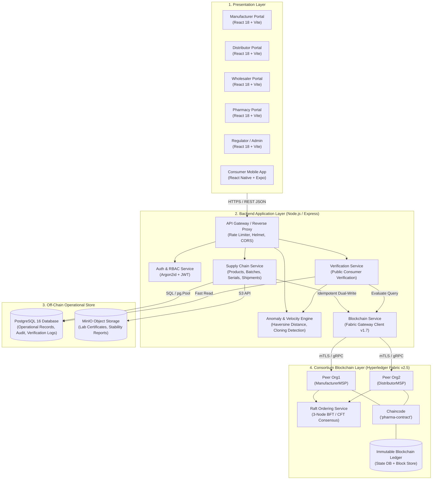
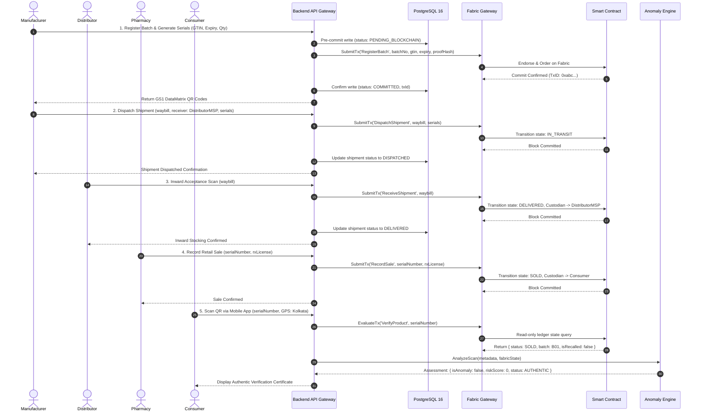
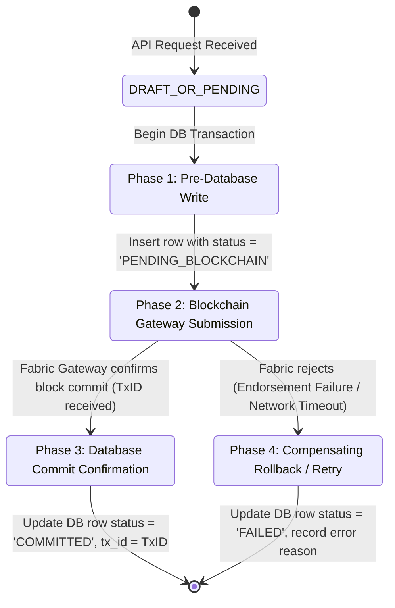

# System Architecture: 4-Tier Hybrid Traceability Platform

**Academic Research Prototype**  
**Institution:** Rajendra Mishra School of Engineering Entrepreneurship, IIT Kharagpur  
**Project:** Unified Blockchain-Based Pharmaceutical Traceability Platform  
**Author:** Navendu Maiti (Roll: `25RJ92R01`)  

---

## 1. Architectural Overview & Component Hierarchy

The system employs a **Decoupled 4-Tier Enterprise Architecture** designed to balance high-throughput operational requirements with non-repudiable cryptographic immutability:

1. **Presentation Layer:** Multi-portal web applications (React 18 + Vite) customized for each stakeholder role, plus an Expo-based cross-platform consumer mobile scanner.
2. **Application & Microservices Layer:** Express.js REST API providing business orchestration, role-based access control (RBAC), GS1 formatting, and the Spatio-Temporal Anomaly Engine.
3. **Off-Chain Operational Data Layer:** PostgreSQL 16 relational database for sub-millisecond querying, relational joins, geospatial lookups, and session management, coupled with MinIO object storage for regulatory compliance certificates.
4. **On-Chain Consortium Blockchain Layer:** Hyperledger Fabric v2.5 consortium network enforcing multi-party state machine transitions, X.509 PKI governance, and cryptographic tamper-evidence.

---

## 2. On-Chain vs. Off-Chain Data Allocation Matrix

A fundamental architectural pitfall in enterprise blockchain projects is treating the distributed ledger as a general-purpose database ("blockchain bloat"). Storing large binary payloads, search strings, or high-volume telemetry directly on-chain degrades consensus throughput and violates data protection regulations (e.g. Right to Erasure / GDPR / DPDP Act).

The table below defines the strict data segregation adhered to by this platform:

| Data Entity / Field | Storage Location | Rationale & Governance |
|:---|:---|:---|
| **User Credentials & Passwords** | Off-Chain (PostgreSQL) | Sensitive PII. Stored as salted Argon2id hashes. Never written to blockchain. |
| **User Roles & Session Tokens** | Off-Chain (PostgreSQL) | Ephemeral authorization state managed by central auth service via signed JWTs. |
| **Product Master Data (Names, Form)**| Dual-Store | Off-chain for full-text catalog search; on-chain GTIN and cryptographic hash for tamper-evidence. |
| **Batch Manufacturing & Expiry** | Dual-Store | Off-chain for ERP sync; on-chain for immutable expiration and recall status enforcement. |
| **Proof Hash (Canonical SHA-256)**| On-Chain (Fabric) | 256-bit hash representing production batch metadata; ensures off-chain DB records cannot be silently modified. |
| **Individual Packaging Serials** | Dual-Store | Off-chain for fast barcode generation; on-chain for non-repudiable state transitions (\`CREATED\` $\rightarrow$ \`SOLD\`). |
| **Waybills & Shipment Tracking** | Dual-Store | Off-chain for logistic manifests; on-chain for multi-party dispatch and acceptance signatures. |
| **Custody Transfer History** | On-Chain (Fabric) | Immutable sequence of organizational MSP handovers with cryptographic timestamps. |
| **Lab Certificates & CoA PDFs** | MinIO Object Storage | Large binary assets stored in object storage; cryptographic SHA-256 digest committed on-chain. |
| **Consumer Verification Logs** | Off-Chain (PostgreSQL) | High-volume scanning telemetry (IPs, user-agents, GPS coordinates) analyzed by Anomaly Engine. |
| **Velocity Anomaly Alerts** | Off-Chain (PostgreSQL) | Real-time security scoring and incident management; flags unit as \`SUSPICIOUS\` on-chain if confirmed. |

---

## 3. End-to-End Medicine Lifecycle & Data Flow

The sequence diagram below visualizes the transition of a medicine pack across physical logistics and digital states:

---

## 4. Dual-Write Coordination Pattern & Consistency Guarantees

Hyperledger Fabric and PostgreSQL cannot participate in a shared distributed Two-Phase Commit (2PC) or XA transaction coordinator. Attempting naive concurrent writes without an explicit protocol leads to "Dual-Write Inconsistency" (e.g., database succeeds but blockchain transaction times out, or vice versa).

This platform implements an **Idempotent Outbox State-Machine Pattern**:

### Protocol Execution Details:
1. **Pre-Commit Write (PostgreSQL):** The operational record is persisted with an explicit status of \`PENDING\` or \`PENDING_BLOCKCHAIN\` and a unique business idempotency key.
2. **Blockchain Submission (Fabric Gateway):** The backend client submits the transaction to the endorsing peers and awaits block commitment notification via gRPC stream.
3. **Post-Commit Confirmation (PostgreSQL):** Upon receiving the cryptographically signed commit status and Fabric Transaction ID (\`txId\`), the local database row is updated to \`COMMITTED\` with the immutable transaction hash.
4. **Failure Compensation:** If the blockchain submission fails, the database row is transitioned to \`FAILED\`. Background reconciliation jobs periodically re-evaluate pending states to ensure eventual consistency.

