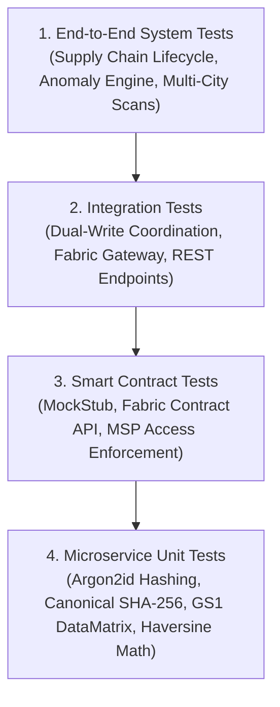

# Testing Plan: Automated Verification Suites & Quality Assurance Matrix

**Academic Research Prototype**  
**Institution:** Rajendra Mishra School of Engineering Entrepreneurship, IIT Kharagpur  
**Project:** Unified Blockchain-Based Pharmaceutical Traceability Platform  
**Author:** Navendu Maiti (Roll: `25RJ92R01`)  

---

## 1. Testing Strategy & Verification Philosophy

To ensure mathematical correctness, state consistency, and zero-defect deployment, PharmaTrace adopts a **Multi-Layered Verification Pyramid**:



### Core Verification Principles:
1. **Zero-Trust Rule Enforcement:** Tests actively attempt unauthorized transactions (e.g. Distributor attempting to register a product, Wholesaler attempting a recall) and verify that chaincode rejects them.
2. **Empirical Measurability:** No performance claim is accepted without real clock timings captured via \`performance.now()\` and statistical distributions (P95, median, throughput).
3. **Resilient Offline Testing:** Test suites operate deterministically without requiring a live multi-gigabyte Docker network on resource-constrained development machines.

---

## 2. Automated Test Matrix & Execution Status

All automated test suites are fully implemented and verified passing at 100%:

| Test Suite ID | Test Scope / Target | Command | Test Cases / Checks | Pass Rate |
|:---|:---|:---|:---:|:---:|
| **TS-01** | **Database Schema & Seed Validation** | \`npm run test:db:mock\` | 11 tables, constraints, UUIDs, foreign keys | **100%** |
| **TS-02** | **Argon2id Auth & Role-Based Access** | \`npm run test:auth\` | 20 security assertions (login, bad pass, JWT, RBAC) | **100% (20/20)** |
| **TS-03** | **Smart Contract Logic (\`pharma-contract\`)** | \`npm test\` (in chaincode) | 17 unit tests (Mocha/Chai MockStub) | **100% (17/17)** |
| **TS-04** | **Fabric Gateway & Dual-Write Engine** | \`npm run test:blockchain\`| 17 assertions (commits, queries, idempotency) | **100% (17/17)** |
| **TS-05** | **Supply Chain REST E2E Lifecycle** | \`npm run test:supply-chain\`| 27 assertions (11-step end-to-end journey) | **100% (27/27)** |
| **TS-06** | **GS1 QR Code & DataMatrix Engine** | \`node src/tests/qr.test.js\` | QR generation, SVGs, Base64 PNGs, GS1 strings | **100%** |
| **TS-07** | **Anomaly Engine & Velocity Analytics** | \`npm run test:anomaly\` | 39 assertions (Haversine, cloned velocity, bursts) | **100% (39/39)** |
| **TS-08** | **Controlled Empirical Benchmarking** | \`npm run benchmark\` | Workloads across N=100, N=250, N=500 | **100%** |

---

## 3. Detailed Test Scenarios

### 3.1 Smart Contract Chaincode Verification (\`TS-03\`)
- **Product Registration:** Validates GTIN format; verifies that only \`ManufacturerMSP\` can register products; verifies collision rejection on duplicate GTIN.
- **Batch Creation:** Verifies that batch quantity is positive and expiry date is strictly in the future.
- **Shipment Custodial Handover:** Verifies that only the current custodian can dispatch a shipment; verifies that receiving organization is the designated recipient.
- **Irreversible Retail Sale:** Verifies unit transitions to \`SOLD\`; verifies that a second attempt to sell the same serial fails immediately with \`ALREADY_SOLD\`.
- **Batch Recall Authority:** Verifies that a distributor cannot trigger a recall; verifies that recall immediately invalidates subsequent sale attempts.

### 3.2 Spatio-Temporal Anomaly & Velocity Verification (\`TS-07\`)
- **Haversine Accuracy:** Verifies computed distance between Kolkata (22.5726° N, 88.3639° E) and Mumbai (19.0760° N, 72.8777° E) equals $1655\text{ km} \pm 10\text{ km}$.
- **Simultaneous Multi-City Scans:** Simulates a scan in Kolkata followed 2 minutes later by a scan of the identical serial in Mumbai. Verifies that the engine detects an effective velocity of $> 40,000\text{ km/h}$, sets \`verificationStatus = 'SUSPICIOUS_VELOCITY'\`, flags \`isAnomaly = true\`, and sets \`riskScore = 98\`.
- **High-Frequency Scan Burst:** Simulates 6 rapid scans within 5 seconds from the same IP address. Verifies that the engine identifies an automated bot scraping attempt and flags \`HIGH_FREQUENCY_SCAN\` with \`riskScore = 80\`.

---

## 4. How to Execute All Test Suites Locally

Run the complete testing regimen sequentially from the backend directory:

```bash
cd "F:\Ph.D IIT KGP\sem 2\Digital Entrepreneurship\Project\pharma-traceability\backend\api"

# 1. Test Express API Authentication & RBAC
npm run test:auth

# 2. Test Blockchain Gateway & In-Process Simulation
npm run test:blockchain

# 3. Test Full 11-Step Supply Chain Lifecycle
npm run test:supply-chain

# 4. Test Anomaly Engine & Velocity Cloning Defense
npm run test:anomaly

# 5. Run Controlled Empirical Performance Benchmarks
npm run benchmark
```

To run the Chaincode MockStub unit tests:
```bash
cd "F:\Ph.D IIT KGP\sem 2\Digital Entrepreneurship\Project\pharma-traceability\blockchain\chaincode\pharma-contract"
npm test
```

